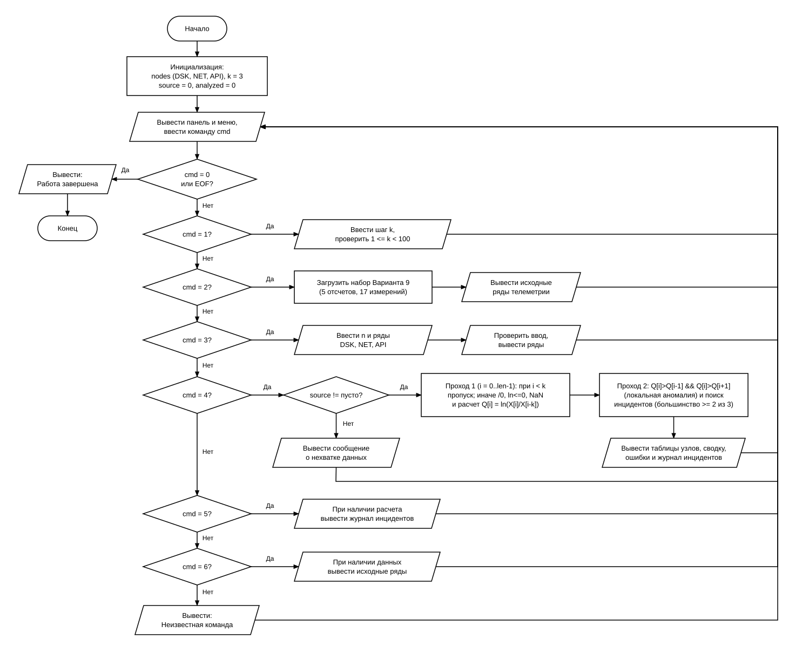

# Курсовой проект: Программа контроля облачной инфраструктуры

## Контрольная точка 2 (КТ2): Структура программы (MVP)

### Назначение программы и описание варианта (Вариант 9)

Программа на языке C предназначена для анализа телеметрических временных рядов облачной инфраструктуры, расчёта производного показателя динамики $Q$, выявления локальных аномалий компонентов и фиксации инцидентов по заданному логическому правилу.

- **Компоненты инфраструктуры:**
  - `DSK` — дисковая подсистема (нагрузка / операции ввода-вывода диска);
  - `NET` — сетевая подсистема (сетевой трафик / задержка передачи);
  - `API` — программный интерфейс / шлюз API (нагрузка и время отклика API).
- **Формат входных данных (Вариант 9):** формат `В` (`компонент–время–значение`, разделитель — запятая). **Тип последовательности (6):** у одного компонента могут быть разные значения на одном отсчёте; все измерения учитываются.
  - На этапе КТ2 программа работает со встроенным контрольным набором варианта 9 (5 отсчётов, все 17 измерений) и ручным вводом рядов по отсчётам (`DSK NET API`); чтение произвольно перемешанных записей формата `В` из файла выполняется на этапе КТ3.
- **Тестовая телеметрия за пять отсчётов (одна строка варианта):**
  ```text
  DSK,2,48.3,API,5,30.9,NET,1,55.6,DSK,5,52.9,NET,4,55.0,NET,3,57.0,DSK,3,46.5,DSK,4,47.0,API,1,33.9,NET,5,53.0,API,3,32.4,API,4,31.6,NET,2,53.6,DSK,4,49.3,DSK,2,46.0,API,2,33.1,DSK,1,45.5
  ```
- **Базовые параметры варианта:** $k = 3$, $L = 1.0$, $D = 10$.

### Математическая модель и правила контроля

1. **Производный показатель $Q$ (логарифм отношения):**
   $$Q[i] = \ln\left(\frac{X[i]}{X[i-k]}\right)$$
   Расчёт выполняется для всех измерений компонента, начиная с индекса $i \ge k$, по паре значений $X[i]$ и $X[i-k]$.
   - Для первых $k$ элементов ($i < k$) расчёт $Q$ не выполняется (недостаточно предыстории), статус расчёта — `CALC_NO_PREV`, состояние компонента — «НОРМА».
   - Если $|X[i-k]| < 10^{-6}$, фиксируется ошибка деления на ноль (`ОШИБКА (/0)`), деление не выполняется, состояние компонента — «ОШИБКА».
   - Если $\frac{X[i]}{X[i-k]} \le 0$ (нулевое значение $X[i]$ либо разные знаки пары), логарифм не определён — фиксируется ошибка области определения (`ОШИБКА (ln<=0)`), состояние компонента — «ОШИБКА».
   - При некорректном числе (`NaN`/`Inf`) фиксируется ошибка значения (`ОШИБКА (NaN)`).
2. **Правило состояния компонента (локальная аномалия):**
   - Если для измерения $i$ показатель $Q[i]$ вычислен корректно, измерение не является крайним ($0 < i < \text{len} - 1$), соседние показатели $Q[i-1]$ и $Q[i+1]$ также вычислены корректно и выполняется:
     $$Q[i] > Q[i-1] \quad \land \quad Q[i] > Q[i+1],$$
     состояние компонента — **«АНОМАЛИЯ»**;
   - иначе — **«НОРМА»** (либо **«ОШИБКА»**, если расчёт $Q[i]$ завершился ошибкой).
3. **Правило инцидента (большинство):**
   Инцидент на отсчёте $t$ возникает, если большинство присутствующих на отсчёте компонентов (при наличии всех трёх — не менее 2 из 3) находятся в состоянии «АНОМАЛИЯ». При наличии нескольких измерений одного компонента на одном отсчёте компонент считается проблемным на этом отсчёте, если хотя бы одно его измерение имеет состояние «АНОМАЛИЯ»:
   $$\text{Incident}(t) = (S_{\text{DSK}}[t] \land S_{\text{NET}}[t]) \lor (S_{\text{DSK}}[t] \land S_{\text{API}}[t]) \lor (S_{\text{NET}}[t] \land S_{\text{API}}[t])$$
   где $S_c[t] \equiv (\text{status}_c[t] == \text{АНОМАЛИЯ})$.

### Организация данных

- Для хранения рядов всех трёх узлов (`DSK`, `NET`, `API`) используется массив структур `NodeSeries nodes[NODE_COUNT]` с фиксированной ёмкостью `SERIES_CAP = 100` (без глобальных переменных) и перечисления (`NodeId`, `CalcCode`, `NodeStatus`, `DataSource`, `MenuCommand`):
  ```c
  typedef struct {
      int tick;
      float value;
      float q;
      CalcCode code;
      NodeStatus status;
  } Sample;

  typedef struct {
      const char* tag;
      Sample items[SERIES_CAP];
      int len;
  } NodeSeries;
  ```
- Для хранения выявленных инцидентов используется массив `incident_log[INCIDENT_CAP]` из структур `Incident` (индексы компонентов: `0` — `DSK`, `1` — `NET`, `2` — `API`):
  ```c
  typedef struct {
      int time;
      int type;
      int first;
      int second;
  } Incident;
  ```

---

## 1. Алгоритм и блок-схема

### Алгоритм работы программы

1. Инициализировать структуры узлов (`init_nodes(nodes)`), задать параметры режима по умолчанию: шаг $k = 3$, источник `source = SRC_EMPTY`, флаг расчёта `analyzed = 0`, вывести заголовок (`render_banner()`).
2. В цикле `do-while` отображать текущую панель состояния и меню режима работы (`render_menu()`), считывать команду `cmd` (с проверкой корректности ввода и `EOF`) и обрабатывать выбор через `switch`:
   - **Пункт 1 (`ask_step_k`):** запросить новый шаг сравнения $k$ ($1 \le k < 100$), проверить ввод; при нехватке измерений для предыстории или локальной аномалии вывести предупреждение.
   - **Пункт 2 (`fill_variant_preset`):** загрузить все 17 измерений контрольного набора варианта 9 (7 для `DSK`, по 5 для `NET` и `API`, упорядоченных по отсчётам $t = 1..5$) и вывести исходные ряды (`render_raw_series()`).
   - **Пункт 3 (`read_manual_telemetry`):** запросить количество отсчётов $n$ ($1 \le n \le 100$) и считать тройки значений `DSK NET API` с проверкой корректности ввода.
   - **Пункт 4 (расчёт и вывод результатов):** при наличии загруженных данных для каждого узла выполнить `process_node_series()` в два прохода: сначала расчёт $Q[i]$ через `evaluate_log_ratio()` с проверкой $i < k$, деления на ноль, $\ln(\le 0)$ и `NaN`, затем классификацию локальных аномалий через `classify_sample()` с защитой границ массива. Далее собрать инциденты через `detect_incidents()` с вызовом `node_status_at_tick()` и `majority_rule()`, вывести таблицы узлов, сводку по отсчётам, число ошибок и журнал инцидентов.
   - **Пункт 5 (`render_incident_table`):** при наличии данных и выполненного расчёта вывести журнал выявленных инцидентов.
   - **Пункт 6 (`render_raw_series`):** при наличии данных вывести загруженные исходные ряды телеметрии.
   - **Пункт 0:** завершить работу программы.

### Блок-схема алгоритма (КТ2)



*Исходник схемы для draw.io: [Kursach_KT2_AlgSchema.drawio](Kursach_KT2_AlgSchema.drawio)*

---

## 2. Контрольный пример: ручной расчёт

### Исходные данные телеметрии варианта 9 (упорядочены по отсчётам, учтены все 17 измерений)

| № измерения | `DSK` ($t$: значение) | `NET` ($t$: значение) | `API` ($t$: значение) |
| :---: | :---: | :---: | :---: |
| 1 | $t = 1$: `45.5` | $t = 1$: `55.6` | $t = 1$: `33.9` |
| 2 | $t = 2$: `48.3` | $t = 2$: `53.6` | $t = 2$: `33.1` |
| 3 | $t = 2$: `46.0` | $t = 3$: `57.0` | $t = 3$: `32.4` |
| 4 | $t = 3$: `46.5` | $t = 4$: `55.0` | $t = 4$: `31.6` |
| 5 | $t = 4$: `47.0` | $t = 5$: `53.0` | $t = 5$: `30.9` |
| 6 | $t = 4$: `49.3` | — | — |
| 7 | $t = 5$: `52.9` | — | — |

### Вариант расчёта 1: базовый шаг $k = 3$

- **`DSK` (7 измерений):**
  - №1–3 ($i < 3$): расчёт не выполняется, состояние — `НОРМА`.
  - №4 ($t = 3$, пара с №1): $Q[3] = \ln(46.5 / 45.5) \approx \mathbf{+0.02174}$ (нет левого соседа $Q$ $\rightarrow$ `НОРМА`).
  - №5 ($t = 4$, пара с №2): $Q[4] = \ln(47.0 / 48.3) \approx \mathbf{-0.02728}$ (меньше обоих соседей $\rightarrow$ `НОРМА`).
  - №6 ($t = 4$, пара с №3): $Q[5] = \ln(49.3 / 46.0) \approx \mathbf{+0.06928}$ ($+0.06928 < +0.12895$ $\rightarrow$ `НОРМА`).
  - №7 ($t = 5$, пара с №4): $Q[6] = \ln(52.9 / 46.5) \approx \mathbf{+0.12895}$ (последний элемент ряда $\rightarrow$ `НОРМА`).
- **`NET` (5 измерений):**
  - №1–3 ($i < 3$): расчёт не выполняется (`НОРМА`).
  - №4 ($t = 4$): $Q[3] = \ln(55.0 / 55.6) \approx \mathbf{-0.01085}$ (`НОРМА`); №5 ($t = 5$): $Q[4] = \ln(53.0 / 53.6) \approx \mathbf{-0.01126}$ (`НОРМА`).
- **`API` (5 измерений):**
  - №1–3 ($i < 3$): расчёт не выполняется (`НОРМА`).
  - №4 ($t = 4$): $Q[3] = \ln(31.6 / 33.9) \approx \mathbf{-0.07026}$ (`НОРМА`); №5 ($t = 5$): $Q[4] = \ln(30.9 / 33.1) \approx \mathbf{-0.06878}$ (`НОРМА`).
- **Инциденты при $k = 3$:** не обнаружены (аномалий нет).

### Вариант расчёта 2: проверка переменного шага $k = 2$

- **`DSK`:** №3..7 $\rightarrow$ `+0.01093`, `-0.03798`, `+0.02151`, `+0.05847`, `+0.11826` (локальных максимумов нет $\rightarrow$ все `НОРМА`).
- **`NET`:** №3 ($t = 3$): $+0.02487$; №4 ($t = 4$): $\mathbf{+0.02578}$ (`АНОМАЛИЯ`, так как больше $+0.02487$ и больше $-0.07276$); №5 ($t = 5$): $-0.07276$.
- **`API`:** №3..5 $\rightarrow$ `-0.04526`, `-0.04638`, `-0.04740` (все `НОРМА`).
- **Инциденты при $k = 2$:** не обнаружены (в аномалии только 1 из 3 узлов — правило большинства не выполнено).

### Вариант расчёта 3: проверка переменного шага $k = 1$ (срабатывание инцидента)

- **`DSK`:** на №4 ($t = 3$, `46.50`): $Q = \ln(46.5 / 46.0) \approx \mathbf{+0.01081} > -0.04879$ и $> +0.01070$ $\rightarrow$ `АНОМАЛИЯ`.
- **`NET`:** на №3 ($t = 3$, `57.00`): $Q = \ln(57.0 / 53.6) \approx \mathbf{+0.06150} > -0.03663$ и $> -0.03572$ $\rightarrow$ `АНОМАЛИЯ`.
- **`API`:** на №3 ($t = 3$, `32.40`): $Q = \ln(32.4 / 33.1) \approx \mathbf{-0.02137} > -0.02388$ и $> -0.02500$ $\rightarrow$ `АНОМАЛИЯ`.
- **Инцидент на $t = 3$:** **Да** (тип `1`, `first = 0 [DSK]`, `second = 1 [NET]`).

### Граничный случай: обработка деления на ноль и $\ln(\le 0)$

При вводе 5 отсчётов и шаге $k = 2$:
- если для `NET` на отсчёте 1 задано `0.0`, а на отсчёте 3 — `40.0`, знаменатель $X[i-2] = 0.0$; программа фиксирует `ОШИБКА (/0)`, не допускает деления и выставляет статус `ОШИБКА`;
- если для `API` на отсчётах 2 и 4 заданы `-5.0` и `30.0` (отношение $-6.0 \le 0$), а на отсчётах 3 и 5 — `25.0` и `0.0` (отношение $0.0 \le 0$), программа фиксирует `ОШИБКА (ln<=0)` без вычисления логарифма и выставляет статус `ОШИБКА`.

---

## 3. Реализация программы

Исходный код программы: [KursovayGubskay/Source.c](KursovayGubskay/Source.c)

Программа разделена на отдельные функции:
- `evaluate_log_ratio` — проверка пары значений $X[i]$ и $X[i-k]$ на конечность (`isfinite`), деление на ноль ($|X[i-k]| < 10^{-6}$), область определения логарифма ($X[i]/X[i-k] > 0$) и расчёт $Q$;
- `classify_sample` — определение состояния измерения (`НОРМА`, `АНОМАЛИЯ`, `ОШИБКА`) с защитой от выхода за границы массива и проверкой обоих соседей;
- `process_node_series` — двухпроходная обработка временного ряда одного узла;
- `node_status_at_tick` — итоговое состояние узла на отсчёте $t$ с учётом нескольких измерений на одном отсчёте;
- `majority_rule` — логическая проверка правила большинства;
- `detect_incidents` — формирование массива структур `Incident`;
- `init_nodes`, `fill_variant_preset`, `read_manual_telemetry`, `ask_step_k` — инициализация, загрузка контрольного набора варианта 9, ручной ввод и настройка шага $k$;
- `render_banner`, `render_menu`, `render_raw_series`, `render_node_table`, `render_timeline_summary`, `render_incident_table` — вывод панелей, таблиц анализа, сводки и журнала инцидентов.

---

## 4. Результаты работы программы

### Тестовый набор варианта 9 при $k = 3$ и $k = 1$

```text
====================================================================
  СИСТЕМА МОНИТОРИНГА ОБЛАЧНОЙ ИНФРАСТРУКТУРЫ  |  Вариант 9 (КТ2)
  Узлы: DSK / NET / API   |   Формула: Q[i] = ln(X[i] / X[i - k])
====================================================================

+------------------------------------------------------------------+
| Источник: не выбран   | Отсч.: 0  (изм.: 0  ) | k = 3  | не расч |
+------------------------------------------------------------------+
  [1] Задать шаг сравнения k
  [2] Загрузить контрольный набор варианта 9 (17 измерений)
  [3] Ввести данные вручную с клавиатуры
  [4] Запустить анализ динамики и вывести отчет
  [5] Показать журнал инцидентов
  [6] Показать загруженные исходные ряды
  [0] Выход из программы
> Выберите команду: 2

[OK] Загружен контрольный набор варианта 9 (5 отсчетов, 17 измерений).

+------------------------------------------------------------------+
|                  ИСХОДНЫЕ ДАННЫЕ ТЕЛЕМЕТРИИ                      |
+------------------------------------------------------------------+
  DSK (7 изм.): [t=1: 45.50] [t=2: 48.30] [t=2: 46.00] [t=3: 46.50] [t=4: 47.00] [t=4: 49.30] [t=5: 52.90]
  NET (5 изм.): [t=1: 55.60] [t=2: 53.60] [t=3: 57.00] [t=4: 55.00] [t=5: 53.00]
  API (5 изм.): [t=1: 33.90] [t=2: 33.10] [t=3: 32.40] [t=4: 31.60] [t=5: 30.90]

> Выберите команду: 4

====================================================================
  ОТЧЕТ ПО АНАЛИЗУ ДИНАМИКИ  (отсчетов: 5, шаг сравнения k = 3)
====================================================================

  Узел DSK (измерений: 7):
  +----+-------+----------+----------+----------------+----------+
  | No | Время |   X[i]   |  X[i-k]  |      Q[i]      |  Статус  |
  +----+-------+----------+----------+----------------+----------+
  | 1  |  1    |    45.50 |    ---   | --- (i < k)    | НОРМА    |
  | 2  |  2    |    48.30 |    ---   | --- (i < k)    | НОРМА    |
  | 3  |  2    |    46.00 |    ---   | --- (i < k)    | НОРМА    |
  | 4  |  3    |    46.50 |    45.50 |       +0.02174 | НОРМА    |
  | 5  |  4    |    47.00 |    48.30 |       -0.02728 | НОРМА    |
  | 6  |  4    |    49.30 |    46.00 |       +0.06928 | НОРМА    |
  | 7  |  5    |    52.90 |    46.50 |       +0.12895 | НОРМА    |
  +----+-------+----------+----------+----------------+----------+

  Узел NET (измерений: 5):
  +----+-------+----------+----------+----------------+----------+
  | No | Время |   X[i]   |  X[i-k]  |      Q[i]      |  Статус  |
  +----+-------+----------+----------+----------------+----------+
  | 1  |  1    |    55.60 |    ---   | --- (i < k)    | НОРМА    |
  | 2  |  2    |    53.60 |    ---   | --- (i < k)    | НОРМА    |
  | 3  |  3    |    57.00 |    ---   | --- (i < k)    | НОРМА    |
  | 4  |  4    |    55.00 |    55.60 |       -0.01085 | НОРМА    |
  | 5  |  5    |    53.00 |    53.60 |       -0.01126 | НОРМА    |
  +----+-------+----------+----------+----------------+----------+

  Узел API (измерений: 5):
  +----+-------+----------+----------+----------------+----------+
  | No | Время |   X[i]   |  X[i-k]  |      Q[i]      |  Статус  |
  +----+-------+----------+----------+----------------+----------+
  | 1  |  1    |    33.90 |    ---   | --- (i < k)    | НОРМА    |
  | 2  |  2    |    33.10 |    ---   | --- (i < k)    | НОРМА    |
  | 3  |  3    |    32.40 |    ---   | --- (i < k)    | НОРМА    |
  | 4  |  4    |    31.60 |    33.90 |       -0.07026 | НОРМА    |
  | 5  |  5    |    30.90 |    33.10 |       -0.06878 | НОРМА    |
  +----+-------+----------+----------+----------------+----------+

  Сводка состояний по отсчетам:
  +-------+----------+----------+----------+----------+
  | Время |   DSK    |   NET    |   API    | Инцидент |
  +-------+----------+----------+----------+----------+
  |  1    | НОРМА    | НОРМА    | НОРМА    |   нет    |
  |  2    | НОРМА    | НОРМА    | НОРМА    |   нет    |
  |  3    | НОРМА    | НОРМА    | НОРМА    |   нет    |
  |  4    | НОРМА    | НОРМА    | НОРМА    |   нет    |
  |  5    | НОРМА    | НОРМА    | НОРМА    |   нет    |
  +-------+----------+----------+----------+----------+

  Всего ошибок вычисления формулы Q: 0

  Журнал инцидентов (правило большинства: >= 2 из 3 узлов в АНОМАЛИЯ):
  -> Инцидентов не зарегистрировано.

> Выберите команду: 1
Введите новый шаг k (1..99): 1
[OK] Установлен шаг сравнения k = 1.

> Выберите команду: 4

====================================================================
  ОТЧЕТ ПО АНАЛИЗУ ДИНАМИКИ  (отсчетов: 5, шаг сравнения k = 1)
====================================================================

  Узел DSK (измерений: 7):
  +----+-------+----------+----------+----------------+----------+
  | No | Время |   X[i]   |  X[i-k]  |      Q[i]      |  Статус  |
  +----+-------+----------+----------+----------------+----------+
  | 1  |  1    |    45.50 |    ---   | --- (i < k)    | НОРМА    |
  | 2  |  2    |    48.30 |    45.50 |       +0.05972 | НОРМА    |
  | 3  |  2    |    46.00 |    48.30 |       -0.04879 | НОРМА    |
  | 4  |  3    |    46.50 |    46.00 |       +0.01081 | АНОМАЛИЯ |
  | 5  |  4    |    47.00 |    46.50 |       +0.01070 | НОРМА    |
  | 6  |  4    |    49.30 |    47.00 |       +0.04778 | НОРМА    |
  | 7  |  5    |    52.90 |    49.30 |       +0.07048 | НОРМА    |
  +----+-------+----------+----------+----------------+----------+

  Узел NET (измерений: 5):
  +----+-------+----------+----------+----------------+----------+
  | No | Время |   X[i]   |  X[i-k]  |      Q[i]      |  Статус  |
  +----+-------+----------+----------+----------------+----------+
  | 1  |  1    |    55.60 |    ---   | --- (i < k)    | НОРМА    |
  | 2  |  2    |    53.60 |    55.60 |       -0.03663 | НОРМА    |
  | 3  |  3    |    57.00 |    53.60 |       +0.06150 | АНОМАЛИЯ |
  | 4  |  4    |    55.00 |    57.00 |       -0.03572 | НОРМА    |
  | 5  |  5    |    53.00 |    55.00 |       -0.03704 | НОРМА    |
  +----+-------+----------+----------+----------------+----------+

  Узел API (измерений: 5):
  +----+-------+----------+----------+----------------+----------+
  | No | Время |   X[i]   |  X[i-k]  |      Q[i]      |  Статус  |
  +----+-------+----------+----------+----------------+----------+
  | 1  |  1    |    33.90 |    ---   | --- (i < k)    | НОРМА    |
  | 2  |  2    |    33.10 |    33.90 |       -0.02388 | НОРМА    |
  | 3  |  3    |    32.40 |    33.10 |       -0.02137 | АНОМАЛИЯ |
  | 4  |  4    |    31.60 |    32.40 |       -0.02500 | НОРМА    |
  | 5  |  5    |    30.90 |    31.60 |       -0.02240 | НОРМА    |
  +----+-------+----------+----------+----------------+----------+

  Сводка состояний по отсчетам:
  +-------+----------+----------+----------+----------+
  | Время |   DSK    |   NET    |   API    | Инцидент |
  +-------+----------+----------+----------+----------+
  |  1    | НОРМА    | НОРМА    | НОРМА    |   нет    |
  |  2    | НОРМА    | НОРМА    | НОРМА    |   нет    |
  |  3    | АНОМАЛИЯ | АНОМАЛИЯ | АНОМАЛИЯ |   ДА     |
  |  4    | НОРМА    | НОРМА    | НОРМА    |   нет    |
  |  5    | НОРМА    | НОРМА    | НОРМА    |   нет    |
  +-------+----------+----------+----------+----------+

  Всего ошибок вычисления формулы Q: 0

  Журнал инцидентов (правило большинства: >= 2 из 3 узлов в АНОМАЛИЯ):
  +-------+-----+--------------+--------------+
  | Время | Тип |    first     |    second    |
  +-------+-----+--------------+--------------+
  |  3    |  1  | [0] DSK      | [1] NET      |
  +-------+-----+--------------+--------------+
```

### Проверка деления на ноль и $\ln(\le 0)$ (ручной ввод, 5 отсчётов, $k = 2$)

```text
> Выберите команду: 3

Введите число отсчетов (1..100): 5
  Отсчет #1 -> введите DSK NET API через пробел: 10 0 20
  Отсчет #2 -> введите DSK NET API через пробел: 12 50 -5
  Отсчет #3 -> введите DSK NET API через пробел: 15 40 25
  Отсчет #4 -> введите DSK NET API через пробел: 16 42 30
  Отсчет #5 -> введите DSK NET API через пробел: 17 44 0

[OK] Принято отсчетов с клавиатуры: 5.
...
> Выберите команду: 4

  Узел NET (измерений: 5):
  +----+-------+----------+----------+----------------+----------+
  | No | Время |   X[i]   |  X[i-k]  |      Q[i]      |  Статус  |
  +----+-------+----------+----------+----------------+----------+
  | 1  |  1    |     0.00 |    ---   | --- (i < k)    | НОРМА    |
  | 2  |  2    |    50.00 |    ---   | --- (i < k)    | НОРМА    |
  | 3  |  3    |    40.00 |     0.00 | ОШИБКА (/0)    | ОШИБКА   |
  | 4  |  4    |    42.00 |    50.00 |       -0.17435 | НОРМА    |
  | 5  |  5    |    44.00 |    40.00 |       +0.09531 | НОРМА    |
  +----+-------+----------+----------+----------------+----------+

  Узел API (измерений: 5):
  +----+-------+----------+----------+----------------+----------+
  | No | Время |   X[i]   |  X[i-k]  |      Q[i]      |  Статус  |
  +----+-------+----------+----------+----------------+----------+
  | 1  |  1    |    20.00 |    ---   | --- (i < k)    | НОРМА    |
  | 2  |  2    |    -5.00 |    ---   | --- (i < k)    | НОРМА    |
  | 3  |  3    |    25.00 |    20.00 |       +0.22314 | НОРМА    |
  | 4  |  4    |    30.00 |    -5.00 | ОШИБКА (ln<=0) | ОШИБКА   |
  | 5  |  5    |     0.00 |    25.00 | ОШИБКА (ln<=0) | ОШИБКА   |
  +----+-------+----------+----------+----------------+----------+

  Всего ошибок вычисления формулы Q: 3
```

---

## 5. Вывод

В ходе выполнения второго этапа спроектирована модульная структура программы контроля облачной инфраструктуры для варианта 9, добавлены массивы структур для расчёта по паре $X[i]$ и $X[i-k]$ с настраиваемым шагом $k$, обработаны первые $k$ элементов, деление на ноль и недопустимый аргумент логарифма, реализован двухпроходный поиск локальных аномалий, правило инцидента большинства и меню настройки режима работы. Результаты работы программы полностью совпали с контрольными ручными расчётами.

---

## 6. Информация о разработчике

- **Студент:** Губский Данил Максимович
- **Группа:** бОТИ-261
- **Год:** 2026
