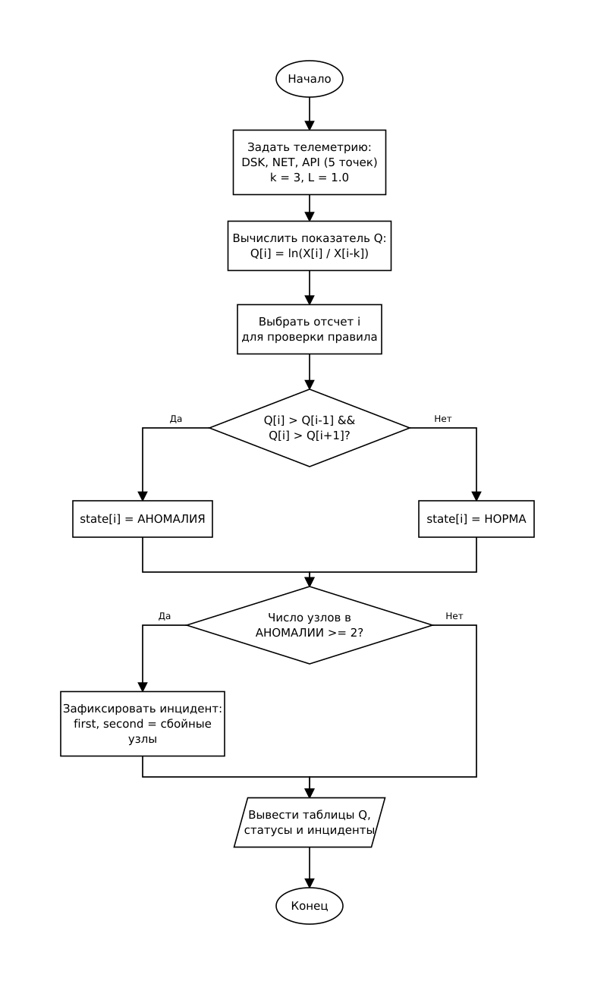
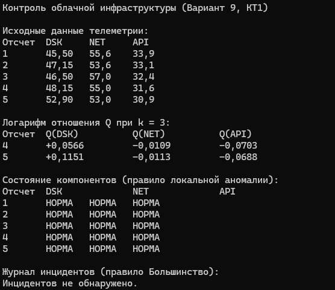

# Курсовой проект: Программа контроля облачной инфраструктуры

## Контрольная точка 1:

### Вариант 9

- **Компоненты:** `DSK`, `NET`, `API`
- **Порядок записи во входных данных:** формат `В` (`компонент время значение`, разделитель — запятая).
- **Тип последовательности (6):** у одного компонента могут быть разные значения на одном отсчёте; все измерения учитываются.
- **Телеметрия за пять отсчётов - одна строка:**

  DSK,2,48.3,API,5,30.9,NET,1,55.6,DSK,5,52.9,NET,4,55.0,NET,3,57.0,DSK,3,46.5,DSK,4,47.0,API,1,33.9,NET,5,53.0,API,3,32.4,API,4,31.6,NET,2,53.6,DSK,4,49.3,DSK,2,46.0,API,2,33.1,DSK,1,45.5

- **Производный показатель $Q$:** 
  $$Q[i] = \ln\left(\frac{X[i]}{X[i-k]}\right)$$
  
  **Параметры:**
 `k = 3, L = 1.0, D = 10.`
- **Правило состояния компонента (Локальная аномалия):**  
  Если текущее $Q$ больше предыдущего и следующего ($Q[i] > Q[i-1]$ и $Q[i] > Q[i+1]$), состояние **«АНОМАЛИЯ»**, иначе **«НОРМА»**.
- **Правило инцидента (Большинство):**  
  Инцидент возникает, если большинство присутствующих компонентов ($\ge 2$ из 3) находятся в проблемном состоянии:
  `Incident(t) = (S_DSK[t] ∧ S_NET[t]) ∨ (S_DSK[t] ∧ S_API[t]) ∨ (S_NET[t] ∧ S_API[t])`
- **Структура Incident:**
  ```
  typedef struct {
      int time;
      int type;
      int first;
      int second;
  } Incident;
  ```
  Поля: номер отсчёта (`time`), тип (`type`), индексы двух проблемных компонентов (`first`, `second`).

---

## 1. Алгоритм и блок-схема

### Описание алгоритма

1. Задать массивы телеметрии из карточки варианта для трёх компонентов (`DSK`, `NET`, `API`) на 5 отсчётов времени ($t = 1 \dots 5$). Для компонента `DSK`, имеющего на отсчётах 2 и 4 повторные измерения (тип 6), учесть все поступившие значения путём усреднения на соответствующем отсчёте.
2. Задать параметры: шаг сравнения $k = 3$, порог $L = 1.0$.
3. Для каждого компонента вычислить показатель $Q[i] = \ln(X[i] / X[i-k])$ для доступных пар (отсчёты $i = 4, 5$).
4. Определить состояние компонентов по правилу «Локальная аномалия»:
   - для отсчётов $t = 1, 2, 3$ пар со сдвигом $k = 3$ нет $\rightarrow$ статус «НОРМА»;
   - для отсчётов $t = 4, 5$ проверить условие $Q[i] > Q[i-1]$ и $Q[i] > Q[i+1]$: при отсутствии одного из соседей (граничные элементы) условие локального максимума не выполняется $\rightarrow$ статус «НОРМА».
5. Проверить возникновение инцидента по правилу «Большинство»: если не менее 2 компонентов находятся в состоянии «АНОМАЛИЯ», зафиксировать инцидент, сохранив номер отсчёта, тип и индексы двух сбойных узлов (`first` и `second`).
6. Вывести исходные данные, рассчитанные показатели $Q$, состояния компонентов и журнал инцидентов.

### Блок-схема алгоритма (КТ1)



---

## 2. Контрольный пример: ручной расчёт

### Исходные данные телеметрии

- `API`: 5 измерений ($t=1 \dots 5$);
- `NET`: 5 измерений ($t=1 \dots 5$);
- `DSK`: 7 измерений (на $t=2$ значения $48.3$ и $46.0$; на $t=4$ значения $47.0$ и $49.3$).

Согласно типу последовательности (6) все измерения учитываются. При формировании временного ряда значения на одинаковых отсчётах усредняются:
- $X_{\text{DSK}}[2] = \frac{48.3 + 46.0}{2} = 47.15$
- $X_{\text{DSK}}[4] = \frac{47.0 + 49.3}{2} = 48.15$

| Отсчёт ($t$) | DSK ($X_1$) | NET ($X_2$) | API ($X_3$) |
| :---: | :---: | :---: | :---: |
| 1 | 45.50 | 55.6 | 33.9 |
| 2 | 47.15 | 53.6 | 33.1 |
| 3 | 46.50 | 57.0 | 32.4 |
| 4 | 48.15 | 55.0 | 31.6 |
| 5 | 52.90 | 53.0 | 30.9 |


### Ручной расчёт производного показателя $Q$ ($k = 3$)

Формула: $Q[i] = \ln\left(\frac{X[i]}{X[i-3]}\right)$

- **Отсчёт $t = 4$ (пара с $t = 1$):**
  - $\text{DSK}: Q[4] = \ln\left(\frac{48.15}{45.50}\right) = \ln(1.058242) \approx \mathbf{+0.0566}$  
  - $\text{NET}: Q[4] = \ln\left(\frac{55.0}{55.6}\right) = \ln(0.989209) \approx \mathbf{-0.0109}$
  - $\text{API}: Q[4] = \ln\left(\frac{31.6}{33.9}\right) = \ln(0.932153) \approx \mathbf{-0.0703}$

- **Отсчёт $t = 5$ (пара с $t = 2$):**
  - $\text{DSK}: Q[5] = \ln\left(\frac{52.90}{47.15}\right) = \ln(1.121951) \approx \mathbf{+0.1151}$  
  - $\text{NET}: Q[5] = \ln\left(\frac{53.0}{53.6}\right) = \ln(0.988806) \approx \mathbf{-0.0113}$
  - $\text{API}: Q[5] = \ln\left(\frac{30.9}{33.1}\right) = \ln(0.933535) \approx \mathbf{-0.0688}$

### Определение состояний и инцидентов

Правило состояния «Локальная аномалия»: $Q[i] > Q[i-1]$ и $Q[i] > Q[i+1]$.  
Для краевых элементов и элементов без полной пары соседей условие строгого локального максимума не выполняется, поэтому состояние остаётся «НОРМА».

| Отсчёт ($t$) | $Q(\text{DSK})$ | $Q(\text{NET})$ | $Q(\text{API})$ | Статус DSK | Статус NET | Статус API | Инцидент |
| :---: | :---: | :---: | :---: | :---: | :---: | :---: | :---: |
| 1 | — | — | — | НОРМА | НОРМА | НОРМА | Нет |
| 2 | — | — | — | НОРМА | НОРМА | НОРМА | Нет |
| 3 | — | — | — | НОРМА | НОРМА | НОРМА | Нет |
| 4 | $+0.0566$ | $-0.0109$ | $-0.0703$ | НОРМА | НОРМА | НОРМА | Нет |
| 5 | $+0.1151$ | $-0.0113$ | $-0.0688$ | НОРМА | НОРМА | НОРМА | Нет |

Булево выражение инцидента («Большинство»):
$$\text{Incident}(t) = (S_{\text{DSK}}[t] \land S_{\text{NET}}[t]) \lor (S_{\text{DSK}}[t] \land S_{\text{API}}[t]) \lor (S_{\text{NET}}[t] \land S_{\text{API}}[t])$$

Ожидаемый результат на пяти отсчётах: все компоненты в норме, инциденты отсутствуют.

---

## 3. Реализация программы

Исходный код программы: [Source.c](Source.c)

---

## 4. Результаты работы программы




Вывод программы полностью совпадает с ручным контрольным расчётом.

---

## 5. Вывод

В ходе выполнения контрольной точки 1 реализован базовый расчёт логарифма отношения динамики компонентов, проверено правило локальной аномалии и сформирована логика выявления инцидентов по правилу большинства для тестового набора отсчётов.

---

## 6. Информация о разработчике

- **Студент:** Губский Данил Максимович
- **Группа:** бОТИ-261


