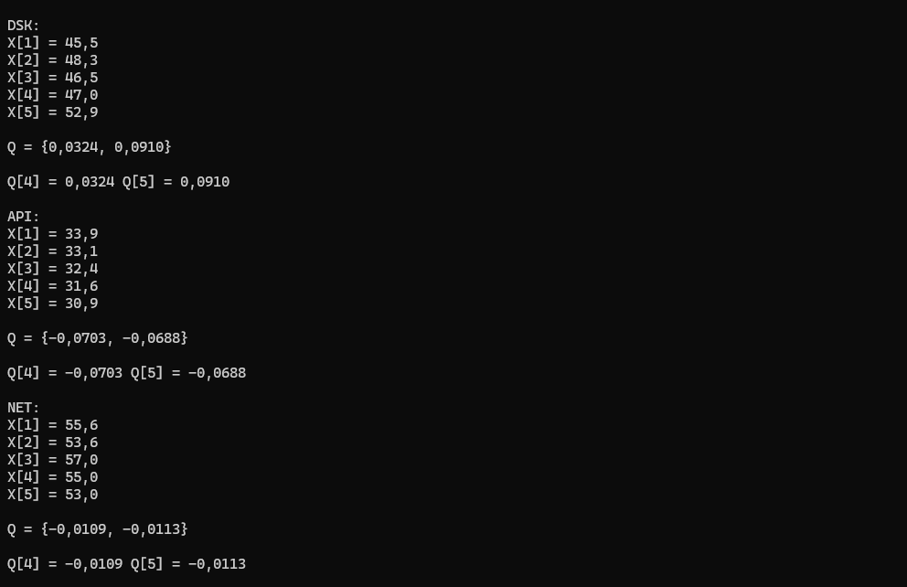

# Курсовой проект: Программа контроля облачной инфраструктуры

## Контрольная точка 1:

### Вариант 9:
#### 1. Назначение программы:

Программа на языке C предназначена для анализа телеметрических данных трёх компонентов системы (DSK, API и NET). Программа получает последовательные измерения показателей каждого компонента, формирует временные ряды, вычисляет производные показатели динамики по логарифмической формуле, анализирует полученные значения и выявляет возможные отклонения от нормы. При превышении установленного порога в двух последовательных измерениях программа формирует предупреждение о состоянии соответствующего компонента.

#### 2. Описание индивидуального варианта

- **Компоненты:** `DSK`, `NET`, `API`
- **Порядок записи во входных данных:** формат `В` (`компонент время значение`, разделитель — запятая).
- **Тип последовательности (6):** у одного компонента могут быть разные значения на одном отсчёте; все измерения учитываются.
- **Телеметрия за пять отсчётов - одна строка:**

  DSK,2,48.3,API,5,30.9,NET,1,55.6,DSK,5,52.9,NET,4,55.0,NET,3,57.0,DSK,3,46.5,DSK,4,47.0,API,1,33.9,NET,5,53.0,API,3,32.4,API,4,31.6,NET,2,53.6,DSK,4,49.3,DSK,2,46.0,API,2,33.1,DSK,1,45.5

- **Производный показатель $Q$: Логарифм отношения**
  
- **Формула:**
  $$Q[i] = \ln\left(\frac{X[i]}{X[i-k]}\right)$$
  
  **Параметры:**
 `k = 3, L = 1.0, D = 10.`
- **Правило состояния компонента:**  
  Если текущее $Q$ больше предыдущего и следующего `(Q[i] > Q[i-1] и Q[i] > Q[i+1])`, состояние **«АНОМАЛИЯ»**, иначе **«НОРМА»**.
- **Правило инцидента (Большинство):**  
  Инцидент возникает, если большинство присутствующих компонентов ($\ge 2$ из 3) находятся в проблемном состоянии:
  
  `Incident(t) = (S_DSK[t] ∧ S_NET[t]) ∨ (S_DSK[t] ∧ S_API[t]) ∨ (S_NET[t] ∧ S_API[t])`
- **Структура Incident:**
  ```
  typedef struct {
      int time;
      int type;
      int first;
      int second;
  } Incident;
  ```
  Поля: номер отсчёта (`time`), тип (`type`), индексы двух проблемных компонентов (`first`, `second`).
  
  Проверь: вручную рассчитай Q для доступных пар, определи состояния компонентов и запиши булево выражение инцидента.

---
## Таблица компонентов по времени

| t | Компонент | Значение |
|---|-----------|----------|
| 1 | NET | 36.6|
| 1 | API | 48.6 |
| 1 | DSK | 37.5 |
| 2 | NET | 38.1 |
| 2 | DSK | 38.2 |
| 2 | API | 49.4 |
| 3 | NET | 39.9 |
| 3 | DSK | 38.9 |
| 3 | API | 50.5 |
| 4 | NET | 42.7 |
| 4 | DSK | 45.6 |
| 4 | API | 51.3 |
| 5 | API | 55.0 |
| 5 | DSK | 48.8 |
| 5 | NET | 45.0 |


## Ручной расчёт производных показателей

```text
DSK
Q[2] = ln(47.0 / 45.5) = +0.0324
Q[3] = ln(47.0 / 45.5) = +0.0324
Q[4] = ln(47.0 / 45.5) = +0.0324
Q[5] = ln(52.9 / 48.3) = +0.0909

API
Q[2] = ln(47.0 / 45.5) = +0.0324
Q[3] = ln(47.0 / 45.5) = +0.0324
Q[4] = ln(31.6 / 33.9) = -0.0703
Q[5] = ln(30.9 / 33.1) = -0.0688

NET
Q[2] = ln(47.0 / 45.5) = +0.0324
Q[3] = ln(47.0 / 45.5) = +0.0324
Q[4] = ln(55.0 / 55.6) = -0.0109
Q[5] = ln(53.0 / 53.6) = -0.0113
```


---

## Ручное определение ожидаемого результата исходя из правила контроля


DSK: Q = {+0.0324, +0.0909}

Q[2] = +0.0324

Q[3] = +0.0324

Q[4] = +0.0324 — нет предыдущего значения

Q[5] = +0.0909 — нет следующего значения


Состояние DSK = НОРМА

API: Q = {-0.0703, -0.0688}

Q[2] = +0.0324

Q[3] = +0.0324

Q[4] = -0.0703 — нет предыдущего значения

Q[5] = -0.0688 — нет следующего значения


Состояние API = НОРМА


NET: Q = {-0.0109, -0.0113}

Q[2] = +0.0324

Q[3] = +0.0324

Q[4] = -0.0109 — нет предыдущего значения

Q[5] = -0.0113 — нет следующего значения

Состояние NET = НОРМА


---

## Результаты работы программы





---
## Сравнение программы с ручным расчётом

Программа не может посчитать, является число нормой или предупреждением, так как для $Q[4]$ нет прошлого числа, а для $Q[5]$ нет следующего. Но числа полностью совпадают с ручным расчётом.

## Вывод

В ходе выполнения работы реализован расчёт логарифма отношения телеметрических параметров компонентов по формуле $Q[i] = \ln(X[i] / X[i-3])$, а также сформирована логика вывода значений для каждого компонента, полностью соответствующих ручному расчёту для контрольных отсчётов.

---

## Информация о разработчике

- **Студент:** Губский Данил Максимович
- **Группа:** бОТИ-261


